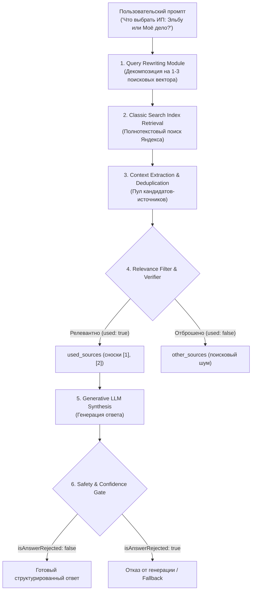

# Yandex Generative Search Probe (RAG Reverse-Engineering Tool)

<p align="left">
  
  
  
  
</p>

Инструмент реверс-инжиниринга и эмпирического аудита продакшн-контура генеративного поиска Яндекса (`/v2/gen/search`). 

Репозиторий содержит воспроизводимый скрипт анализа без сторонних зависимостей (`probe.py`) и сырой датасет из **160 регламентных запросов** (493 извлеченные ссылки на 185 уникальных доменах) по трём контрастным сегментам: федеральный FinTech/SaaS для бизнеса, локальные медицинские клиники и узкая нормативная B2B-документация.

---

## 1. Исходные данные и структура датасета

- **Период замеров:** сентябрь 2026
- **Метод сбора:** официальный HTTP POST эндпоинт `https://searchapi.api.cloud.yandex.net/v2/gen/search`
- **Общий объём:** 160 регламентных вызовов
- **Парных контрольных прогонов:** 40 (повторный замер через интервал времени для оценки стохастичности)
- **Уникальных доменов в выборке:** 185
- **Всего проанализировано ссылок:** 493

### Параметры срезов:

| Срез | Файл датасета | Запросов | Ссылок / Доменов | Концентрация ТОП-10 | Особенность сегмента |
|---|---|---:|---:|---:|---|
| **FinTech & SaaS** | `data/ip-services-2026.jsonl` | 80 (40 × 2) | 250 / 81 | 34.4% | Высокая конкуренция медиа, банков и блогов |
| **Локальные услуги** | `data/dentistry-saratov-2026.jsonl` | 40 | 131 / 38 | **73.3%** | Жесткая олигополия геосервисов и агрегаторов |
| **B2B нормативка** | `data/ppk-audit-2026.jsonl` | 40 | 112 / 66 | 35.7% | Сайты прямых исполнителей, агрегаторов 0% |

```
Структура сырой записи (JSONL):
{
  "question": "Какой сервис онлайн-бухгалтерии лучше для ИП на УСН?",
  "run": 1,
  "ts": "2026-09-17T23:33:40",
  "answer": "...",               // Текст генеративного синтеза (Markdown)
  "used_sources": [...],          // Ссылки, на которые модель поставила сноски [1], [2]
  "other_sources": [...],         // Найденные поиском, но отброшенные документы
  "search_queries": [...],        // Декомпозированные поисковые запросы к индексу
  "rejected": false,              // Флаг подавления ответа (safety / low confidence)
  "bullet": false                 // Режим списочной фактологии vs связного синтеза
}
```

---

## 2. Подтверждённая архитектура RAG-пайплайна

В отличие от классического поискового API (XML со сниппетами), эндпоинт `/v2/gen/search` реализует полный контур Retrieval-Augmented Generation с внутренним контролем достоверности:



### Недокументированные поля ответа:

1. **`searchQueries` (Query Rewriting):** Внутренняя легковесная модель трансформирует естественный язык пользователя в поисковый синтаксис.
2. **`sources[].used` (Context Gate):** Разделение на фактические источники синтеза и фоновый поисковый мусор. В среднем модель отбрасывает от 35% до 60% найденных документов.
3. **`isAnswerRejected` (Safeguard):** Срабатывает при обнаружении регуляторных ограничений (медицина/фарма) или критической нехватке достоверных фактов в `used_sources`.
4. **`isBulletAnswer`:** Флаг структурного режима.

---

## 3. Подтверждённые аномалии RAG

### 3.1 Слепое цитирование (Blind Citation) vs Фантомная память

При сопоставлении цитируемости сайтов (`used_sources`) и упоминаемости брендов в синтезированном тексте выявлен фундаментальный дисбаланс:

| Бренд / Сервис | Упоминание в тексте | Сайт в used_sources | Характер расхождения |
|---|---:|---:|---|
| **Контур.Эльба** | **16%** | **10%** | Бренд помнят лучше сайта |
| **Точка Банк** | **9%** | **19%** | 🔻 **Слепое цитирование x2**: сайт берут в 2 раза чаще, чем называют бренд |
| **Бизнес.ру** | **0%** | **10%** | 🔻 **Абсолютное слепое цитирование**: 8 цитат контента, 0 упоминаний бренда |
| **МТС Банк** | **0%** | **4%** | Контент используется как справочник, имя вырезается |
| **1С** | **2%** | **0%** | 🔺 **Фантомная память**: бренд из весов модели без ссылок на сайт |
| **ЮKassa** | **0%** | **0%** | Полное выпадение из генеративного контекста |

**Механика:** Модель решает задачу экстрактивной суммаризации фактов. Если статья портала содержит полезную формулу расчета налога, LLM извлекает суть и ставит сноску `[1]`, но в текст имя портала не включает, так как оно семантически избыточно для ответа на вопрос пользователя.

---

### 3.2 Доменная энтропия и олигополия платформ

Распределение ссылок кардинально различается в зависимости от природы рынка:

- **Локальный гео-рынок (Стоматологии):**
  - Доля ТОП-10 доменов: **73.3%**
  - Лидеры: `prodoctorov.ru` (12.2%), `maps.yandex.ru` (11.5%), `2gis.ru` (9.2%), `docdoc.ru` (9.2%), `32top.ru` (6.9%).
  - Сайты самих клиник: суммарно лишь 22.9%.
  - **Аномалия клиники «Территория Улыбки»:** названа в **12 ответах из 40** (30% всей выдачи города), но её собственный сайт процитирован **ровно 1 раз**. Репутация сформирована агрегаторами.
- **B2B нормативка (ППК общепита):**
  - Доля ТОП-10 доменов: **35.7%**
  - Доля агрегаторов: **0.0%**
  - Лидируют сайты прямых экспертных центров и лабораторий (`sanmosdez.ru`, `romashka-audit.ru`). Ни один сайт не держит более 6% рынка.

---

### 3.3 Детерминизм RAG-контура (Jaccard Stability Index)

Для проверки гипотезы о стохастичности 40 вопросов были заданы повторно с временным лагом. Мера сходства множеств доменов оценивалась через коэффициент Жаккара:

$$J(A, B) = \frac{|A \cap B|}{|A \cup B|}$$

Факты (`probe.py jaccard data/ip-services-2026.jsonl`):

- Сравниваемых пар: `40`
- Полное совпадение источников ($J = 1.0$): `28 / 40` (**70.0%**)
- Медиана сходства: **`1.0000`**
- Среднее сходство: **`0.8658`**
- Минимум: `0.3333`
- Пар с нулевым пересечением ($J = 0.0$): **`0`**

**Инженерный вывод:** Контур поиска и отбора источников в Яндексе **строго детерминирован**. Стохастичность генеративного ответа ограничена декодером языковой модели (температурой генерации текста), в то время как поисковый индекс подаёт на вход модели идентичный пул документов.

---

### 3.4 Декомпозиция сложных интентов (Query Rewriting)

При сравнительных и составных вопросах модель разделяет интент на подзапросы:

```text
Промпт: "Что выбрать ИП без сотрудников: Эльбу или Моё дело?"
↳ Поисковый запрос 1: "ип без сотрудников моё дело"
↳ Поисковый запрос 2: "ип без сотрудников эльба или моё дело"
↳ Поисковый запрос 3: "ип без сотрудников эльба"
```

Модель изолирует сущности сравнения и опрашивает индекс по каждой сущности отдельно плюс по их прямому сопоставлению.

---

## 4. Быстрый старт и воспроизведение

Скрипт не требует установки сторонних библиотек (`pip install` не нужен).

### Анализ готовых датасетов:

```bash
# 1. Расчет стабильности источников (Jaccard Index)
python3 probe.py jaccard data/ip-services-2026.jsonl

# 2. Анализ доменной энтропии и концентрации ТОП-10
python3 probe.py entropy data/dentistry-saratov-2026.jsonl --top 10

# 3. Проверка цитируемости vs упоминаемости брендов
python3 probe.py report data/ip-services-2026.jsonl \
  --brands "Контур.Эльба|elba|e-kontur.ru; Точка|tochka.com; 1С|1c.ru; Бизнес.ру|business.ru"

# 4. Просмотр примеров Query Rewriting
python3 probe.py rewriting data/ip-services-2026.jsonl --limit 5
```

### Запуск собственных замеров:

```bash
export YANDEX_API_KEY="your-api-key"
export YANDEX_FOLDER_ID="your-folder-id"

python3 probe.py ask questions/ip-services.txt --out data/my-run.jsonl --runs 2
```

*(Скрипт автоматически соблюдает лимит Search API в 1 rps).*

---

## 5. Структура репозитория

```
yandex-gen-search-probe/
├── probe.py                      # CLI-утилита анализа и сбора (zero-dependency)
├── data/
│   ├── ip-services-2026.jsonl     # 80 ответов (FinTech, 40 вопросов × 2 прогона)
│   ├── dentistry-saratov-2026.jsonl # 40 ответов (локальная медицина)
│   └── ppk-audit-2026.jsonl      # 40 ответов (B2B нормативка)
├── questions/
│   ├── ip-services.txt           # Список вопросов по FinTech
│   ├── dentistry-saratov.txt     # Список вопросов по медицине
│   └── ppk-audit.txt             # Список вопросов по B2B нормативке
├── .gitignore
├── LICENSE                       # MIT
└── README.md
```

---

## 6. Лицензия и контакты

Распространяется под лицензией MIT.

- **Автор исследования:** [Mak7u](https://github.com/A-Mak7u)
- **Telegram-канал:** [@kto_v_otvete](https://t.me/kto_v_otvete) — инженерные замеры, реверс-инжиниринг протоколов и изнанка Рунета.
